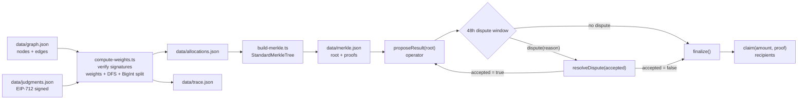
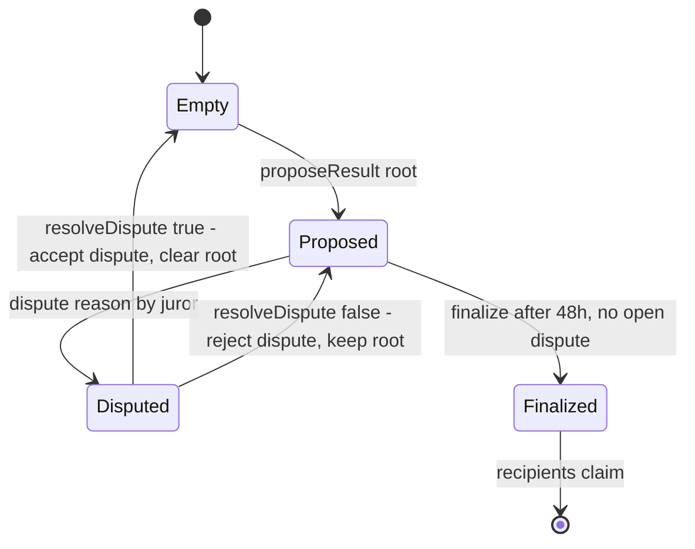
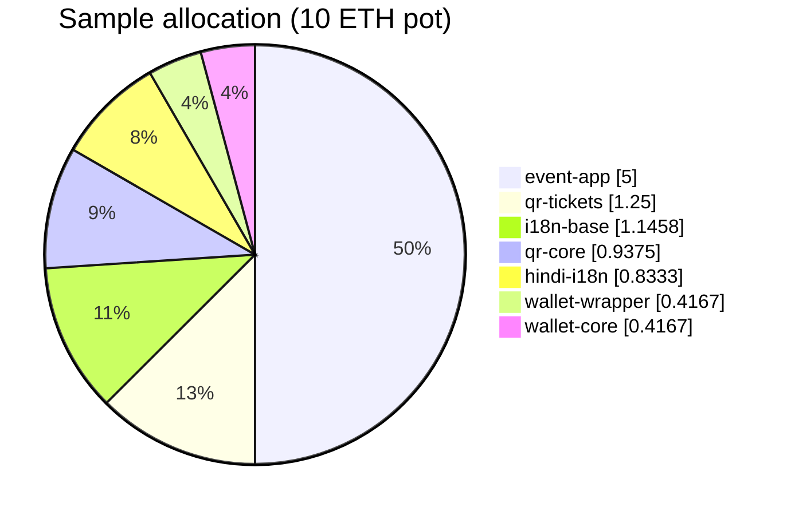
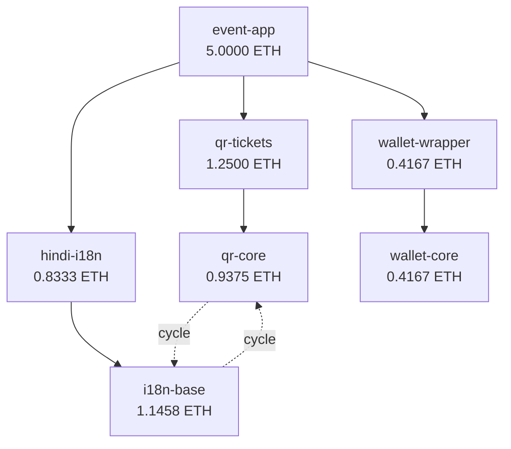

# devcon11-ps3-pay-the-wells

Jury-weighted retro-funding for a dependency graph, settled onchain with a Merkle root, a 48-hour
dispute window, and pull-based ETH claims.

> Road to Devcon XI — Problem 3. Offchain allocation is computed in BigInt, committed onchain, and
> claimed leaf by leaf. Contract and tooling are unaudited; do not use with real funds.


**Jump to:** [Live deployment](#live-deployment-sepolia) · [Working flow](#working-flow) ·
[Allocation chart](#allocation-chart) · [Allocation table](#allocation-table) ·
[Developer guide](#developer-guide) · [Contract API](#contract-api) ·
[Operations runbook](#operations-runbook) · [Troubleshooting](#troubleshooting)

---

## Live deployment (Sepolia)

| Item | Value |
| --- | --- |
| Contract | [`0xc02f9570f0B7DAB6B12B7ba6d453e5e302A4ec22`](https://sepolia.etherscan.io/address/0xc02f9570f0B7DAB6B12B7ba6d453e5e302A4ec22) |
| Deploy tx | [`0x1d55a2cd8b4ad599fb8ec0760739671dde86a9bfbc92504171e944c061114542`](https://sepolia.etherscan.io/tx/0x1d55a2cd8b4ad599fb8ec0760739671dde86a9bfbc92504171e944c061114542) |
| `proposeResult` tx | [`0x4076712e3115f78836dec89c86c455731c5717279de76539b94e78fe3aa602c4`](https://sepolia.etherscan.io/tx/0x4076712e3115f78836dec89c86c455731c5717279de76539b94e78fe3aa602c4) |
| Chain ID | `11155111` |
| Operator | `0x22b94a9953dB57760eF54f010bA304a79bFAbeD2` |
| Juror | `0x55825c4A63627E344d5cE8FB5f0C6f8daAc653e0` |
| Recorded pot | `0.01 ETH` (`10000000000000000` wei, `totalPot`; verify the live balance) |
| Proposed Merkle root | `0xe0a4e24507e6da90b6f5c165c46af2ae4a1a12c3cb4ad4804debfbb86bd6c477` |
| Runtime code | 3,063 bytes, starts `0x608060405234801561` |
| Recorded state | Root proposed, `finalized() == false`. Re-read live state before acting; if `proposedAt + 48h` has passed and no dispute is open, `finalize()` is available. |

`deployments/sepolia.json` is the machine-readable deployment metadata (chain, contract, operator,
juror, pot); the tx hashes above are also mirrored in `ui/src/deployment.ts`. The full broadcast is in
`broadcast/Deploy.s.sol/11155111/run-latest.json` (gitignored).

> **Demo funding mismatch — read this before testing claims.** The live contract was deployed with a
> `0.01 ETH` pot, but the committed root encodes the sample `10 ETH` allocation. The live deployment
> demonstrates the proposal step; the test suite covers disputes, finalization, and claims. A full-size
> claim will fail on insufficient balance. To exercise claims end-to-end, either deploy/fund a contract
> with `10 ETH` and propose the same root, or rebuild the data set for `0.01 ETH` and deploy a fresh
> contract with the new root. On the existing contract, a live root can only be replaced after an
> accepted dispute inside the 48-hour window.

---

## TL;DR

```powershell
npm install
npm run pipeline        # compute -> merkle -> verify-merkle
forge test              # 13 unit/fuzz + 1 invariant
npm test                # typecheck + 4 data tests + source scan + proof verification
npm run build           # production UI -> dist-ui/
```

Expected pipeline tail:

```text
Verified 3 EIP-712 jury judgments
Roots: event-app
...
Allocation sum 10000000000000000000 wei == pot 10000000000000000000 wei (potMatches=true)

All 7 proofs valid.
Root: 0xe0a4e24507e6da90b6f5c165c46af2ae4a1a12c3cb4ad4804debfbb86bd6c477
Leaf sum: 10000000000000000000 wei
```

Prerequisites: Node.js **20.11+** (the test harness uses `import.meta.dirname`), npm, and Foundry 1.8+.
`forge-std` is vendored as a submodule; if it is missing run
`forge install foundry-rs/forge-std --no-commit`.

---

## Working flow

The system has three trust boundaries: **offchain allocation** (graph + signed judgments), **onchain
commitment** (root + dispute window), and **pull claims** (proof + ETH transfer). The chart below is
the complete working flow.



### Flow, step by step

| # | Actor | Action | Artifact / event | Check |
| ---: | --- | --- | --- | --- |
| 1 | Maintainer | Describe the dependency graph | `data/graph.json` | Every edge points at a known node; recipients are unique |
| 2 | Juror | Sign a pairwise preference | `data/judgments.json` | EIP-712 signature recovers to `jurorId` |
| 3 | Anyone | Run `npm run compute` | `data/allocations.json`, `data/trace.json` | `sum(allocations) == pot` exactly |
| 4 | Anyone | Run `npm run merkle -- 10` | `data/merkle.json` | Leaves sum to the pot; every proof verifies |
| 5 | Operator | Deploy with the pot and initial jurors | `deployments/sepolia.json` | `cast code` returns non-empty bytecode |
| 6 | Operator | `proposeResult(root)` | `ResultProposed` | `merkleRoot()` equals the local root |
| 7 | Juror | `dispute(reason)` inside 48 h | `Disputed` | `hasOpenDispute() == true` |
| 8 | Operator | `resolveDispute(accepted)` | `DisputeResolved` | `true` clears the root; `false` keeps it |
| 9 | Anyone | `finalize()` after 48 h, no open dispute | `Finalized` | `finalized() == true`; root is now immutable |
| 10 | Recipient | `claim(amount, proof)` | `Claimed` | `claimed(msg.sender) == true`; ETH delivered |
| 11 | Anyone | Inspect and verify | Etherscan / `cast call` | Contract balance + claimed == pot |

### Settlement state machine



> **Naming trap:** `resolveDispute(true)` means “the operator **accepts the juror's dispute**”. The
> proposed root is rejected and cleared, so a new root can be proposed. `resolveDispute(false)` rejects
> the dispute and keeps the root. This is the opposite of “accept the result”.

### 48-hour window

```text
t = 0                                  t = 48h
|------------- dispute open -------------|------------- claims open ------------->
proposeResult(root)                  finalize()                        claim(amount, proof)
                                     (no open dispute)
```

A dispute is allowed while `block.timestamp <= proposedAt + 48 hours`. `finalize()` requires
`block.timestamp >= proposedAt + 48 hours` and `hasOpenDispute == false`. At the exact boundary both
calls are legal, so transaction ordering decides whether a last-second dispute blocks finalization.

---

## Allocation chart

The committed sample spends a **10 ETH** pot. Values are rounded for display; exact wei are in
[the allocation table](#allocation-table).



Plain-text version, proportional to the largest allocation:

```text
event-app        ████████████████████████████████████████  5.000000 ETH  50.00%
qr-tickets       ██████████                                1.250000 ETH  12.50%
i18n-base        █████████                                 1.145833 ETH  11.46%
qr-core          ███████                                   0.937500 ETH   9.38%
hindi-i18n       ██████                                    0.833333 ETH   8.33%
wallet-wrapper   ███                                       0.416667 ETH   4.17%
wallet-core      ███                                       0.416667 ETH   4.17%
                                                            ─────────────────────
                                                            10.000000 ETH 100.00%
```

### Dependency graph



The deliberate cycle is `qr-core ⇄ i18n-base`. A re-entered node still receives the incoming share but
is not traversed again, so the cycle terminates without losing wei. In the sample, `qr-core` gets
contributions from both `qr-tickets` and `i18n-base`; `i18n-base` gets contributions from both
`hindi-i18n` and `qr-core`.

---

## Allocation table

### Final allocations

| Node | ETH | Share | Recipient |
| --- | ---: | ---: | --- |
| `event-app` | 5 | 50.0000% | `0xf39Fd6e51aad88F6F4ce6aB8827279cffFb92266` |
| `qr-tickets` | 1.25 | 12.5000% | `0x70997970C51812dc3A010C7d01b50e0d17dc79C8` |
| `hindi-i18n` | 0.833333333333333333 | 8.3333% | `0x3C44CdDdB6a900fa2b585dd299e03d12FA4293BC` |
| `wallet-wrapper` | 0.416666666666666668 | 4.1667% | `0x90F79bf6EB2c4f870365E785982E1f101E93b906` |
| `qr-core` | 0.9375 | 9.3750% | `0x15d34AAf54267DB7D7c367839AAf71A00a2C6A65` |
| `i18n-base` | 1.145833333333333332 | 11.4583% | `0x9965507D1a55bcC2695C58ba16FB37d819B0A4dc` |
| `wallet-core` | 0.416666666666666667 | 4.1667% | `0x976EA74026E726554dB657fA54763abd0C3a0aa9` |
| **Sum** | **10** | **100.0000%** | **7 leaves** |

### Exact flow trace (wei)

| Node | Primary parent | Received | Kept | Passed | Final allocation |
| --- | --- | ---: | ---: | ---: | ---: |
| `event-app` | root | 10000000000000000000 | 5000000000000000000 | 5000000000000000000 | 5000000000000000000 |
| `qr-tickets` | `event-app` | 2500000000000000000 | 1250000000000000000 | 1250000000000000000 | 1250000000000000000 |
| `hindi-i18n` | `event-app` | 1666666666666666665 | 833333333333333333 | 833333333333333332 | 833333333333333333 |
| `wallet-wrapper` | `event-app` | 833333333333333335 | 416666666666666668 | 416666666666666667 | 416666666666666668 |
| `qr-core` | `qr-tickets` | 1562500000000000000 | 937500000000000000 | 625000000000000000 | 937500000000000000 |
| `i18n-base` | `qr-core` | 1458333333333333332 | 1145833333333333332 | 312500000000000000 | 1145833333333333332 |
| `wallet-core` | `wallet-wrapper` | 416666666666666667 | 416666666666666667 | 0 | 416666666666666667 |
| **Sum** | | | | | **10000000000000000000** |

`keepBps` is `5000` (50%). Each traversal keeps half of the amount it processes and passes half to its
children. A node reached again through the cycle keeps the later incoming share without traversing
again, so multi-parent nodes such as `qr-core` and `i18n-base` do not simply keep 50% of their total
`Received` column.

### Sibling weights

The three direct children of `event-app` are ranked by pairwise judgments. A win adds `1`, a tie adds
`0.5`, and a pair with no judgment is treated as a tie. Scores are normalized per sibling set to WAD
(`1e18`) weights, with the rounding remainder assigned to the last child.

| Parent | Child | Wins (WAD) | Weight (WAD) | Evidence |
| --- | --- | ---: | ---: | --- |
| `event-app` | `qr-tickets` | 1.5 | 0.5 | beat `hindi-i18n`; tied `wallet-wrapper` |
| `event-app` | `hindi-i18n` | 1.0 | 0.333333333333333333 | beat `wallet-wrapper`; lost to `qr-tickets` |
| `event-app` | `wallet-wrapper` | 0.5 | 0.166666666666666667 | tied `qr-tickets`; lost to `hindi-i18n` |
| `qr-tickets` | `qr-core` | 0 | 1.0 | only child |
| `hindi-i18n` | `i18n-base` | 0 | 1.0 | only child |
| `wallet-wrapper` | `wallet-core` | 0 | 1.0 | only child |

The three committed judgments are:

| A | B | Preference | Result |
| --- | --- | --- | --- |
| `qr-tickets` | `hindi-i18n` | `A` | `qr-tickets` +1 |
| `hindi-i18n` | `wallet-wrapper` | `A` | `hindi-i18n` +1 |
| `qr-tickets` | `wallet-wrapper` | `equal` | each +0.5 |

This is a **pairwise win tally normalized per sibling set**, not a maximum-likelihood Bradley-Terry
fit. The UI labels it “Bradley-Terry” for brevity; the exact arithmetic is in `compute-weights.ts`.

---

## How the math works

### 1. Jury weights

For each parent, every unordered pair of its children is scored from the signed judgments:

- a judgment counts if it names the pair in either order;
- `preferred == "A"` gives the win to `packageA`, `"B"` to `packageB`, `"equal"` gives `0.5` to each;
- a pair with no judgments is treated as equal (`0.5` each);
- each child's total score is normalized: `weight = score * WAD / totalScore`;
- the last child gets `WAD - assigned`, so the weights sum to exactly `WAD`.

If every score is zero (for example, one child with no pair to compare), the code falls back to equal
weights.

### 2. Pot traversal

- Roots are nodes with indegree `0`. If there is exactly one root it receives the entire pot; multiple
  roots split the pot evenly, with the remainder going to the last root.
- A global `visited` set makes the DFS cycle-safe. The first visit records the primary parent and
  traverses children; a later visit adds the incoming amount to that node's allocation but does not
  traverse again. This is why `qr-core` and `i18n-base` can receive from multiple paths.
- On a first visit, each node keeps `amount * keepBps / 10_000` and passes the rest to its children by
  weight. Nodes with no children keep everything. A re-entered node keeps the whole incoming share
  without re-splitting it.
- Every split assigns the rounding remainder to the last child. The final assertion is exact:
  `sum(allocations) === pot`. No floats are used anywhere in the money path.
- Traversal depth is capped at `100`; exceeding it throws instead of overflowing the stack.

### 3. Merkle commitment

`build-merkle.ts` builds an OpenZeppelin `StandardMerkleTree` over `[recipient, amount]` values typed
as `["address", "uint256"]`, then re-checks that the leaves sum to the CLI pot and to
`allocations.json`. `StandardMerkleTree` sorts leaves by default, so the allocation order does not
change the root; the **amounts** do change it, including 1-wei rounding differences.

### 4. Exact leaf encoding

`@openzeppelin/merkle-tree` **double-hashes** leaves:

```solidity
leaf = keccak256(bytes.concat(keccak256(abi.encode(msg.sender, amount))));
```

The contract uses the same construction. Single-hashing makes every claim fail with `InvalidProof`.
This is the single most common integration bug in this repo.

---

## Stack

| Layer | Tooling |
| --- | --- |
| Contract | Solidity `0.8.24`, Foundry, OpenZeppelin 5.4 (`ReentrancyGuard`, `MerkleProof`) |
| Offchain pipeline | TypeScript, `tsx`, `@openzeppelin/merkle-tree`, `viem` |
| Frontend | Vite 6, React 18, wagmi v2, viem v2, TanStack Query |
| Data | JSON artifacts committed under `data/` |
| Runtime | Node.js 20.11+, npm |
| Network | Sepolia (`11155111`) |

---

## Repository layout

```text
src/DeepFunding.sol              pot + 48h dispute window + Merkle claims + CEI
test/
  DeepFunding.t.sol              13 unit/fuzz/reentrancy/CEI tests
  DeepFundingInvariant.t.sol     invariant: contract balance + claimed == pot
script/Deploy.s.sol              Sepolia deploy: 0.01 ETH pot, jurors [JUROR_ADDRESS, deployer]
data/
  graph.json                     sample dependency graph with the qr-core/i18n-base cycle
  judgments.json                 3 EIP-712 signed comparisons
  allocations.json               BigInt allocations + exact sum assertion
  trace.json                     per-node parent, contributions, weights, formula
  merkle.json                    root, 7 leaves, proofs
scripts/
  types.ts                       shared strict types (money is always a wei string)
  eip712.ts                      domain + typehash definitions
  compute-weights.ts             signature verification, weights, cycle-safe DFS, pot split
  build-merkle.ts                StandardMerkleTree + exact sum assertion
  verify-merkle.ts               verifies every proof and the leaf sum
  sign-judgment.ts               test-only EIP-712 signer (key from env)
  make-sample-judgments.ts       regenerates the sample judgments (key from env)
  data.test.ts                   node:test cycle/sum/proof/signature checks
  source-scan.mjs                rejects Number(), parseFloat(), and 1e18
ui/
  index.html                     Vite entry
  vite.config.ts                 root = ui/, build output = ../dist-ui/
  src/abi.ts                     contract ABI subset used by wagmi
  src/App.tsx                    hero, stats, wallet bar, section layout
  src/data.ts                    imports bundled JSON artifacts
  src/deployment.ts              known Sepolia record + Etherscan helpers
  src/format.ts                  BigInt-safe ETH/percent/WAD formatting
  src/wagmi.ts                   Sepolia-only injected connector
  src/components/
    DependencyGraph.tsx          SVG graph with clickable nodes and cycle highlighting
    WhyPanel.tsx                 per-node allocation explanation + signed judgments
    OnchainStatus.tsx            live root, balance, dispute countdown, lifecycle stepper
    DisputePanel.tsx             juror-only dispute submission
    ClaimPanel.tsx               proof-backed claim flow
    CopyButton.tsx               clipboard helper
deployments/sepolia.json         public deployment record (address only, no secrets)
foundry.toml                     solc 0.8.24, cancun, fs_permissions read-write "./"
```

---

## Data pipeline

### Inputs

`data/graph.json` is a directed dependency graph:

```json
{
  "nodes": [
    {
      "id": "event-app",
      "name": "Devcon Event App",
      "recipient": "0xf39Fd6e51aad88F6F4ce6aB8827279cffFb92266"
    }
  ],
  "edges": [
    { "from": "event-app", "to": "qr-tickets" }
  ]
}
```

Rules enforced by `parseGraph`:

- node `id` and `name` are non-empty strings;
- every `recipient` is a valid address, and recipients are unique (case-insensitive);
- `from`/`to` must name known nodes; self-edges are rejected;
- at least one node is required; the graph must have at least one indegree-zero root.

`data/judgments.json` is an array of EIP-712 signed comparisons:

```json
{
  "jurorId": "0x55825c4A63627E344d5cE8FB5f0C6f8daAc653e0",
  "packageA": "qr-tickets",
  "packageB": "hindi-i18n",
  "preferred": "A",
  "signature": "0x651555be2edeb9e021b7182823dac649d0d59e70594a20a9d065a0c75a58ff9324d51387612ee81d351e92eab209911d081cc709b3dbbb6a26b507705e08b97e1b"
}
```

`preferred` is `"A"`, `"B"`, or `"equal"`. `compute-weights.ts` recovers each signature with
`verifyTypedData` and throws if it does not match `jurorId`.

### Data artifacts

| File | Written by | Read by | Contains |
| --- | --- | --- | --- |
| `data/graph.json` | hand-maintained | `compute-weights.ts` | nodes and directed edges |
| `data/judgments.json` | `sign-judgment.ts` / `make-sample-judgments.ts` | `compute-weights.ts` | signed pairwise preferences |
| `data/allocations.json` | `compute-weights.ts` | `build-merkle.ts`, UI | `totalPot`, `assertedSum`, `potMatches`, per-node wei |
| `data/trace.json` | `compute-weights.ts` | `WhyPanel.tsx` | parent, contributions, sibling weights, formula |
| `data/merkle.json` | `build-merkle.ts` | `verify-merkle.ts`, UI, tests | root, leaf count, leaves with proofs |
| `deployments/sepolia.json` | `script/Deploy.s.sol` | humans / UI config | chain, contract, operator, juror, pot |

### EIP-712 domain

```text
Domain: { name: "DeepFunding", version: "1", chainId: 11155111 }
Struct: Judgment(string packageA, string packageB, string preferred)
```

The domain is chain-scoped but **not contract-scoped** (no `verifyingContract`). Judgments are
produced before the contract exists, and the offchain verifier is the source of truth for the tally.
Consequence: signatures can be replayed across different deployments on the same chain. Bind the
domain to a verifier contract for production use.

---

## Contract API

`src/DeepFunding.sol` — `contract DeepFunding is ReentrancyGuard`.

### State

| Member | Type | Notes |
| --- | --- | --- |
| `operator` | `address public immutable` | Deployer; proposes roots, adds jurors, resolves disputes |
| `merkleRoot` | `bytes32 public` | Live commitment; zero when none or after an accepted dispute |
| `totalPot` | `uint256 public` | Wei funded at construction; there is no top-up function |
| `proposedAt` | `uint256 public` | Timestamp of the current proposal; zero when none |
| `DISPUTE_WINDOW` | `uint256 public constant` | `48 hours` |
| `finalized` | `bool public` | Terminal flag; never reset |
| `hasOpenDispute` | `bool public` | Blocks finalization while true |
| `jurors` | `mapping(address => bool)` | Registration; operator-controlled |
| `claimed` | `mapping(address => bool)` | Claim marker, written before the ETH transfer |
| `disputed` | `mapping(bytes32 => bool)` | Dispute hash record; not used for gating |

### Functions

| Function | Access | Guards |
| --- | --- | --- |
| `constructor(address[] initialJurors) payable` | anyone | `ZeroAddress` per juror; zero pot is allowed |
| `addJuror(address juror)` | operator | `AlreadyFinalized`, `ZeroAddress` |
| `proposeResult(bytes32 root)` | operator | `AlreadyFinalized`, `AlreadyProposed`, `InvalidRoot` |
| `dispute(string reason)` | juror | `NothingProposed`, `WindowClosed`, `NotJuror` |
| `resolveDispute(bool accepted)` | operator | `NoOpenDispute` |
| `finalize()` | anyone | `AlreadyFinalized`, `NothingProposed`, `WindowNotClosed`, `OpenDispute` |
| `claim(uint256 amount, bytes32[] proof)` | recipient | `NotFinalized`, `AlreadyClaimed`, `InvalidProof`, `TransferFailed`, `nonReentrant` |

Important semantics:

- `proposeResult` allows only one live proposal. `resolveDispute(true)` clears both `merkleRoot` and
  `proposedAt`, allowing a new proposal.
- A live root **cannot be overwritten** while it is proposed. Replacement requires a juror dispute
  inside the window plus `resolveDispute(true)`; after the window, a fresh deployment is the only way
  to change the root.
- `resolveDispute(false)` keeps the root and closes the dispute. `finalize()` can then proceed once
  the window has elapsed.
- `finalize()` is callable by anyone. The UI intentionally does **not** expose it; operators use
  `cast` (see the runbook).
- After finalization, `proposeResult` and `addJuror` revert. The root and juror set are frozen.
- `claim` follows checks-effects-interactions: set `claimed[msg.sender] = true`, emit `Claimed`, then
  transfer ETH. A failed transfer reverts the whole claim.
- The contract has no `receive`/`fallback` and no sweep function. The pot cannot be topped up through
  normal means, and leftover ETH stays in the contract.

### Events

| Event | Emitted when |
| --- | --- |
| `ResultProposed(bytes32 root, uint256 proposedAt)` | operator proposes a root |
| `Disputed(address indexed juror, string reason)` | juror opens a dispute |
| `DisputeResolved(bool accepted)` | operator resolves the open dispute |
| `Finalized(bytes32 root)` | result is finalized |
| `Claimed(address indexed recipient, uint256 amount)` | recipient claims |
| `JurorAdded(address indexed juror)` | constructor or `addJuror` registers a juror |

### Errors

`NotOperator`, `AlreadyProposed`, `NothingProposed`, `WindowClosed`, `WindowNotClosed`, `OpenDispute`,
`AlreadyClaimed`, `InvalidProof`, `AlreadyFinalized`, `NotJuror`, `NotFinalized`, `NoOpenDispute`,
`ZeroAddress`, `InvalidRoot`, `TransferFailed`.

---

## Frontend

```powershell
Copy-Item ui/.env.example ui/.env.local
# VITE_CONTRACT_ADDRESS=0xc02f9570f0B7DAB6B12B7ba6d453e5e302A4ec22
npm run ui:dev
npm run build      # -> dist-ui/
```

The UI has two data sources:

- **Bundled artifacts** (`ui/src/data.ts` imports `data/*.json` at build time): graph, allocations,
  trace, and Merkle leaves. Changing the pipeline output requires a UI rebuild for the static build.
- **Live chain reads** (`wagmi`): root, pot, balance, `proposedAt`, `finalized`, `hasOpenDispute`,
  `claimed`, and `jurors`. `OnchainStatus` polls every 15 seconds.

### Components

| Component | Responsibility | Wallet needed |
| --- | --- | --- |
| `App` / `WalletBar` | layout, totals, connect/disconnect, switch to Sepolia | for wallet actions |
| `OnchainStatus` | live root vs local root, pot/balance/claimed, dispute countdown, lifecycle stepper | no |
| `DependencyGraph` | SVG graph, per-node allocation labels, cycle-edge highlighting, keyboard selection | no |
| `WhyPanel` | exact per-node explanation, contributions, sibling weights, signed judgments, formula | no |
| `DisputePanel` | juror check, reason form, `dispute(reason)` transaction | yes |
| `ClaimPanel` | address lookup in `merkle.leaves`, `claim(amount, proof)`, receipt status | yes |

Wallet behavior:

- Only an injected connector is configured (`ui/src/wagmi.ts`); the app is Sepolia-only.
- Dispute and claim panels check `chainId !== SEPOLIA_CHAIN_ID` and offer a switch button.
- Claim success is shown only when `receipt.status === "success"`.
- Read-only graph, trace, and status views work without a wallet.
- The ABI in `ui/src/abi.ts` is a deliberate subset (reads + `dispute` + `claim`). It does not expose
  `proposeResult`, `finalize`, or `addJuror`.

### UI data and deployment drift

- `ui/src/deployment.ts` hardcodes the known Sepolia address, deploy tx, propose tx, and root. If the
  configured address differs, the UI hides the transaction links.
- `OnchainStatus` compares the onchain root with `data/merkle.json`, not with the hardcoded record.
- When redeploying, update **all** of these: `deployments/sepolia.json`, `ui/src/deployment.ts`,
  `ui/.env.local` / CI env, and the live-deployment table in this README.

---

## Developer guide

### Golden rules

1. **Money is BigInt wei.** Never use `Number()`, `parseFloat()`, or `1e18` in `scripts/` or
   `ui/src/`. `npm run source-scan` enforces this. `parseInt` is acceptable for timestamps, not money.
2. **The pot must balance exactly.** Every computation asserts `sum(allocations) === pot`; the Merkle
   builder asserts the same again. Do not silence these checks.
3. **Leaves are double-hashed.** Keep `build-merkle.ts` and `DeepFunding.claim` in sync.
4. **Keep the contract ABI subset in sync** with `ui/src/abi.ts` and `ui/src/components/*`.
5. **CEI before transfer.** `claimed[msg.sender]` is written before the ETH call; `nonReentrant` is
   the second line of defense.
6. **The root is immutable after finalization.** Any data regeneration after that requires a new
   deployment, not a re-proposal.
7. **Update deployment records together.** A stale address/root/tx in one place produces misleading
   UI and broken runbooks.

### Common tasks

| Task | Commands | Notes |
| --- | --- | --- |
| Recompute after editing graph/judgments | `npm run pipeline` | Fixed at a 10 ETH pot |
| Change the pot | `npm run compute -- --pot 25` then `npm run merkle -- 25` then `npm run verify-merkle` | `pipeline` hardcodes `merkle -- 10`; do not use it for other pots |
| Change the keep fraction | `npm run compute -- --pot 10 --keep-bps 6000` then `npm run merkle -- 10` | `keepBps` is a global CLI flag, not a per-node field |
| Add a graph node | edit `data/graph.json`, run the pipeline | Add `FIXED_POSITIONS` in `DependencyGraph.tsx`; otherwise the fallback layout overlaps |
| Add a judgment | `npm run sign-judgment -- --a X --b Y --prefer A` | Append the printed JSON to `data/judgments.json`, then recompute |
| Regenerate sample judgments | `npm run make-judgments` | Needs `TEST_JUROR_PRIVATE_KEY`; overwrites `data/judgments.json` |
| Rebuild the UI | `npm run build` | Outputs `dist-ui/` |
| Redeploy | `forge test`, then the deploy steps below | Update all deployment records afterward |

`compute-weights.ts` also accepts `--graph`, `--judgments`, `--out`, and `--trace` path overrides.
`build-merkle.ts` takes the pot as a positional argument (default `10`).

### Gotchas and invariants

| Trap | What happens | Fix / rule |
| --- | --- | --- |
| `resolveDispute(true)` | Accepts the **dispute**, clears the root | Use `false` to keep the root |
| Live pot vs committed root | Live pot is `0.01 ETH`; root encodes `10 ETH` | Fund a 10 ETH deployment, or rebuild for 0.01 ETH and deploy fresh |
| Replacing a live root | `proposeResult` reverts with `AlreadyProposed` | A juror must dispute within the window, then `resolveDispute(true)`; after the window, redeploy |
| A node receives zero wei | `build-merkle.ts` rejects `amount <= 0` | Every node must be reachable and receive at least 1 wei |
| `--keep-bps 10000` | All children receive zero, Merkle build fails | Use `< 10000`; the sample uses `5000` |
| Multiple roots | Pot is split evenly, remainder to the last root | Usually keep exactly one indegree-zero root |
| Duplicate recipient | `parseGraph` and `build-merkle` reject it | One recipient per node; leaf identity is `(address, amount)` |
| Edge/child order changes | Last-child rounding can shift by 1 wei, changing the root | Treat the graph order as part of the committed data |
| Merkle leaf order | `StandardMerkleTree` sorts leaves by default | Order does not change the root; amounts do |
| `npm run pipeline` after `--pot 25` | Merkle step still uses 10 and fails the sum check | Run `compute`, `merkle -- 25`, `verify-merkle` explicitly |
| Stale UI data | JSON is bundled at build time | Re-run pipeline and rebuild `dist-ui/` |
| Claim before finalize | Reverts with `NotFinalized` | Wait for `finalize()` |
| Claim with wrong address | No leaf for the connected address | Claim from a recipient address in `merkle.json` |
| Claim on underfunded contract | `TransferFailed` / insufficient balance | Fund the contract or use a smaller root |
| Dispute after window | Reverts with `WindowClosed` | Dispute while `block.timestamp <= proposedAt + 48h` |
| Finalize with open dispute | Reverts with `OpenDispute` | Operator must `resolveDispute(...)` first |
| Signature replay | EIP-712 domain has no `verifyingContract` | Bind to a verifier contract for production |
| “Bradley-Terry” label | Arithmetic is a pairwise win tally | Read `computeWeights`; do not assume a fitted model |
| `disputed` mapping | Recorded but not used for gating | `hasOpenDispute` is the gate |
| Local countdown drift | UI uses the browser clock and 15s polling | Trust `proposedAt` onchain for exact timing |
| Foundry broad FS access | `fs_permissions` grants read-write `./` | Keep scripts reviewed; do not run untrusted scripts |
| Deploy JSON on failed broadcast | Script body runs even if broadcast fails | Always verify with `cast code` |

### Debugging checklist

1. **Pipeline fails on signatures** — check that `jurorId` matches the signer, the node IDs exist, and
   the signature is 65 bytes. Regenerate with `npm run make-judgments` or `sign-judgment.ts`.
2. **Pipeline fails on the sum** — inspect `data/allocations.json` and the CLI pot. The compute step and
   the Merkle step must use the same pot.
3. **Merkle step rejects an allocation** — find the node with `amount <= 0`; it is unreachable, has a
   zero share, or `keepBps` is too high.
4. **Onchain root mismatch** — compare `cast call $c "merkleRoot()(bytes32)"` with `data/merkle.json`.
   Recompute, then re-propose only if the current root was cleared by an accepted dispute.
5. **Claim reverts** — check `finalized()`, `claimed(address)`, the chain ID, the leaf amount/proof, and
   the contract balance.
6. **UI shows “not configured”** — set a valid `VITE_CONTRACT_ADDRESS` in `ui/.env.local` and restart
   Vite.
7. **UI root badge says “differs”** — the chain has an older root or the local data was rebuilt; do not
   claim until they match.
8. **`cast code` returns `0x`** — the address was never deployed (a failed broadcast still writes the
   predicted address). Re-broadcast and verify.

### PR / release checklist

```powershell
npm run pipeline
npm test
forge test
npm run build
```

- [ ] `data/allocations.json`, `data/trace.json`, and `data/merkle.json` are regenerated together.
- [ ] `npm run source-scan` is clean.
- [ ] No secrets, RPC keys, or private keys are tracked.
- [ ] Deployment address, tx hashes, root, and README table agree.
- [ ] UI data was rebuilt after the pipeline.
- [ ] Contract ABI changes are mirrored in `ui/src/abi.ts`.
- [ ] New nodes have unique IDs/recipients and a layout position in `DependencyGraph.tsx`.

---

## Tests

```powershell
forge test -vv
npm test
```

### Foundry

| Suite | Count | Covers |
| --- | ---: | --- |
| `DeepFundingTest` | 13 | operator gating, happy claim, bad proof, double claim, window, disputes, re-proposal, immutability, reentrancy, CEI, fuzz |
| `DeepFundingInvariantTest` | 1 | `totalClaimed <= totalPot` and `contractBalance + totalClaimed == totalPot` |

Fuzz runs: `256`. Invariant runs: `64`, depth `32`. The invariant suite calls `claim` through a handler
and swallows expected reverts.

### TypeScript / data

| Check | What it proves |
| --- | --- |
| `npm run typecheck` | strict TypeScript for scripts and UI (`noUncheckedIndexedAccess`, `exactOptionalPropertyTypes`) |
| `npm run test:data` | sample cycle exists; allocation sum is exact; every proof verifies; every judgment signature recovers |
| `npm run source-scan` | no `Number()`, `parseFloat()`, or `1e18` in `scripts/` or `ui/src/` |
| `npm run verify-merkle` | every leaf proof verifies and the leaf sum equals `totalPot` |

`npm test` runs all four in that order. `forge test` is separate because it compiles Solidity.

---

## Deploying

### Environment

`.env` at the repo root (gitignored). `.env.example` documents the keys.

| Variable | Required | Notes |
| --- | --- | --- |
| `PRIVATE_KEY` | yes | Funded deployer; becomes `operator` |
| `SEPOLIA_RPC_URL` | yes | Any Sepolia endpoint |
| `JUROR_ADDRESS` | yes | **20-byte address**, not a key |
| `TEST_JUROR_PRIVATE_KEY` | test only | Only for regenerating sample judgments |
| `VITE_CONTRACT_ADDRESS` | UI | In `ui/.env.local`; public address only |
| `VITE_SEPOLIA_RPC_URL` | optional | Dedicated Sepolia RPC for the UI |

`.env` is untracked; `deployments/sepolia.json` contains public chain data only.

### Deploy steps

```powershell
# 1. Load .env into the process (never echo PRIVATE_KEY).
Get-Content .env | ForEach-Object {
  if ($_ -match '^([^#=]+)=(.*)$') { Set-Item -Path "Env:$($matches[1])" -Value $matches[2].Trim() }
}

# 2. Rebuild artifacts and the data set.
#    Use a pot that matches Deploy.s.sol POT (0.01 ETH) if you want claims to succeed.
forge clean; forge build
npm run compute -- --pot 10   # change both pot values to 0.01 to match the default deploy
npm run merkle -- 10          # must match the compute pot exactly

# 3. Broadcast. See "Gas" below for why the multiplier is required.
forge script script/Deploy.s.sol:Deploy --rpc-url $env:SEPOLIA_RPC_URL `
  --broadcast --gas-estimate-multiplier 900

# 4. Prove bytecode exists before trusting the JSON record.
$contract = (Get-Content deployments/sepolia.json | ConvertFrom-Json).contract
cast code $contract --rpc-url $env:SEPOLIA_RPC_URL      # must start 0x6080, never 0x

# 5. Propose the committed root.
#    Warning: the default deploy uses a 0.01 ETH pot while this root encodes 10 ETH.
#    Claims will not be fundable unless you change POT and the data set first.
$root = (Get-Content data/merkle.json | ConvertFrom-Json).root
cast send $contract "proposeResult(bytes32)" $root `
  --rpc-url $env:SEPOLIA_RPC_URL --private-key $env:PRIVATE_KEY

# 6. Read back.
cast call $contract "merkleRoot()(bytes32)" --rpc-url $env:SEPOLIA_RPC_URL
```

The deploy script funds the contract with `0.01 ETH` and registers `[JUROR_ADDRESS, deployer]`. If you
want claims to succeed for the 10 ETH sample, change `POT` in `script/Deploy.s.sol` (and fund the
deployer) or rebuild the data for `0.01 ETH`; either way, deploy a fresh contract. A proposal already
live on the old contract cannot be overwritten after its dispute window closes.

### Gas

Sepolia's execution gas for **contract creation** is far above the local revm estimate used by
`forge script` (measured ~4x for an empty contract, ~6.7x for `DeepFunding`). A plain transfer still
costs 21,000, but deploying an empty contract costs ~210,000 and the full `DeepFunding` init code costs
~5.4M. The default `--gas-estimate-multiplier 130` therefore OOGs, and `--gas-limit` is only an alias
for `--block-gas-limit` (simulation), so it does not help. Use `--gas-estimate-multiplier 900`.

### `vm.writeJson` behavior

`foundry.toml` grants:

```toml
fs_permissions = [{ access = "read-write", path = "./" }]
```

`script/Deploy.s.sol` writes `deployments/sepolia.json` **after broadcasting** — but Foundry runs the
script body even when the broadcast fails, so the file can contain a predicted address that was never
deployed. Always confirm with `cast code` before committing the record.

---

## Operations runbook

```powershell
$c = "0xc02f9570f0B7DAB6B12B7ba6d453e5e302A4ec22"
$rpc = $env:SEPOLIA_RPC_URL
$env:RECIPIENT_ADDRESS = "0x..."   # the address whose leaf you want to claim
```

**Propose** (operator):

```powershell
cast send $c "proposeResult(bytes32)" (Get-Content data/merkle.json | ConvertFrom-Json).root `
  --rpc-url $rpc --private-key $env:PRIVATE_KEY
```

**Dispute** (registered juror, within 48h):

```powershell
cast send $c "dispute(string)" "root does not match published trace" `
  --rpc-url $rpc --private-key $env:TEST_JUROR_PRIVATE_KEY
```

**Resolve** (operator): `true` accepts the dispute and rejects the root, allowing a new proposal;
`false` rejects the dispute and keeps the root.

```powershell
cast send $c "resolveDispute(bool)" true --rpc-url $rpc --private-key $env:PRIVATE_KEY
```

**Finalize** (anyone, after the window, no open dispute):

```powershell
cast send $c "finalize()" --rpc-url $rpc --private-key $env:PRIVATE_KEY
```

**Claim** (recipient):

```powershell
# Pick the leaf for the recipient, then format the proof as a Solidity array.
$leaf = (Get-Content data/merkle.json | ConvertFrom-Json).leaves |
  Where-Object { $_.recipient -eq $env:RECIPIENT_ADDRESS }
$proof = "[" + (($leaf.proof) -join ",") + "]"

cast send $c "claim(uint256,bytes32[])" $leaf.amount $proof `
  --rpc-url $rpc --private-key $env:RECIPIENT_PRIVATE_KEY
```

**Inspect state**:

```powershell
cast call $c "merkleRoot()(bytes32)"        --rpc-url $rpc
cast call $c "proposedAt()(uint256)"        --rpc-url $rpc
cast call $c "finalized()(bool)"            --rpc-url $rpc
cast call $c "hasOpenDispute()(bool)"       --rpc-url $rpc
cast call $c "totalPot()(uint256)"          --rpc-url $rpc
cast balance $c                             --rpc-url $rpc
cast call $c "jurors(address)(bool)" $env:JUROR_ADDRESS --rpc-url $rpc
cast call $c "claimed(address)(bool)" $env:RECIPIENT_ADDRESS --rpc-url $rpc
```

`scan` the events with:

```powershell
cast logs --from-block 0 --address $c "ResultProposed(bytes32,uint256)" --rpc-url $rpc
cast logs --from-block 0 --address $c "Disputed(address,string)" --rpc-url $rpc
cast logs --from-block 0 --address $c "Claimed(address,uint256)" --rpc-url $rpc
```

---

## Troubleshooting

| Symptom | Cause | Fix |
| --- | --- | --- |
| `cast code` returns `0x` | Address was never deployed (predicted address written by a failed broadcast) | Re-broadcast and verify `0x6080…` |
| `Transaction Failure` with `gasUsed == gasLimit` | Creation OOG from the low local estimate | `--gas-estimate-multiplier 900` |
| `WrongChain(1)` / `WrongChain(...)` | RPC is not Sepolia | Point `SEPOLIA_RPC_URL` at chain `11155111` |
| `vm.envAddress: failed parsing as address` | `JUROR_ADDRESS` holds a key instead of an address | Set the 20-byte juror address |
| `AlreadyProposed` | A root is already live | A juror dispute plus `resolveDispute(true)` resets it, or finalize the existing root; after the window, redeploy |
| `NoOpenDispute` | `resolveDispute` called with no open dispute | Wait for a juror dispute; only then can the operator resolve it |
| `WindowNotClosed` | `finalize()` before `proposedAt + 48h` | Wait out the window |
| `OpenDispute` | A juror dispute is unresolved | Operator calls `resolveDispute` |
| `NotJuror` | Disputer is not registered | `addJuror` (operator, pre-finalization) |
| `InvalidProof` | Leaf built with single hashing or wrong amount | Rebuild from `data/merkle.json` with the double-hashed leaf |
| `TransferFailed` / claim reverts with balance error | Contract pot is smaller than the leaf amount | Fund the contract or use a root sized to the pot |
| `fs_permissions` denial on `vm.writeJson` | Path not granted | `fs_permissions = [{ access = "read-write", path = "./" }]` |
| UI says “not configured” | No valid `VITE_CONTRACT_ADDRESS` | Set it in `ui/.env.local`, restart Vite, rebuild |
| UI root badge says “differs” | Local `data/merkle.json` and onchain root disagree | Recompute from the same inputs, or point the UI at a deployment whose root matches |
| `npm run pipeline` fails at `merkle` after changing pot | Pipeline hardcodes `merkle -- 10` | Run compute, merkle with the new pot, and verify separately |
| Source scan fails | A float money operation was introduced | Use BigInt/`formatEther`; remove `Number()`, `parseFloat()`, `1e18` |

---

## Security model and limits

- **Unaudited.** Testnet-only demonstration. Do not use with real funds.
- **Trusted operator.** The operator proposes the root, registers jurors, and resolves disputes. The
  48-hour window is the social backstop, not a cryptographic guarantee.
- **Offchain jury tally.** Judgments are verified offchain; the chain only sees the Merkle root. A
  compromised operator can commit an arbitrary root, subject to juror dispute and social review.
- **No contract-scoped EIP-712 domain.** Signatures are scoped to chain ID `11155111`, not to a
  specific deployment. Bind the domain to a verifier for production.
- **No juror stake or slashing.** Jurors can dispute but have no bonded economic security.
- **No top-ups or emergency sweep.** `totalPot` is fixed at construction; ETH sent by force (for
  example `selfdestruct`) is not accounted for. Unclaimed ETH remains in the contract.
- **Underfunded roots are possible.** The contract does not compare the root's implied total to its
  balance. Claims fail if the pot is too small; this is exactly the live demo's `0.01 ETH` vs `10 ETH`
  mismatch.
- **Reverting recipients cannot claim.** `claim` reverts if the ETH transfer fails; there is no
  pull-payment fallback to an escrow.
- **`claim` is `nonReentrant` and CEI-ordered.** The claimed marker is set before the transfer, and a
  reentrant call cannot drain the pot.
- **Finalized results are immutable.** After `finalize()`, the root and juror set cannot change.
- **Test-only signer.** `sign-judgment.ts` and `make-sample-judgments.ts` use a key from `.env`;
  production should use hardware wallets and a deployed verifier.
- **No secrets committed.** `npm run source-scan` and the credential grep below enforce this.

### Credential check

```powershell
git ls-files | Select-String -Pattern '(^|/)\.env$'
git grep -nEi '(private|secret|mnemonic|passphrase|api.?key).{0,30}0x[0-9a-fA-F]{64}' -- .
git grep -nEi 'infura\.io/v3/|alchemy\.com/v2/|api[_-]?key=|apikey=' -- .
```

Expected: only `.env.example` / `ui/.env.example` are tracked, and no assignments or provider keys
match.

---

## npm scripts

| Script | What it does |
| --- | --- |
| `npm run compute -- --pot 10` | Verify EIP-712 judgments, compute pairwise weights, run cycle-safe DFS, split the pot, write `data/allocations.json` + `data/trace.json` |
| `npm run merkle -- 10` | Build `StandardMerkleTree` over `[recipient, amount]` leaves, assert exact sum, write `data/merkle.json` |
| `npm run verify-merkle` | Re-verify every proof in `data/merkle.json` |
| `npm run pipeline` | `compute` → `merkle -- 10` → `verify-merkle` |
| `npm test` | `typecheck` + `test:data` + `source-scan` + `verify-merkle` |
| `npm run typecheck` | TypeScript checks for `scripts/` and `ui/src/` |
| `npm run test:data` | Node test runner: cycle, exact sum, proofs, signatures |
| `npm run source-scan` | Fails on `Number(`, `parseFloat(`, or `1e18` in `scripts/` and `ui/src/` |
| `npm run sign-judgment -- --a X --b Y --prefer A` | Test-only EIP-712 signer (uses `TEST_JUROR_PRIVATE_KEY`) |
| `npm run make-judgments` | Regenerates `data/judgments.json` from the hardcoded sample comparisons |
| `npm run ui:dev` | Vite dev server for the UI |
| `npm run build` | Typecheck + production UI build into `dist-ui/` |

---

## Conventions

- **BigInt only** for money. `source-scan.mjs` fails the build on `Number()`, `parseFloat()`, or
  `1e18` in `scripts/` and `ui/src/`.
- Allocation math asserts `sum == pot` exactly; the rounding remainder goes to the last child/root.
- Leaf encoding must stay in sync between `build-merkle.ts` and `DeepFunding.claim`.
- Data artifacts are committed; regenerate all three (`allocations`, `trace`, `merkle`) together.
- Keep `ui/src/abi.ts`, the contract, and the README API table in sync.
- Commits: `contract:`, `offchain:`, `ui:`, `deploy:`, `docs:` prefixes.
- Treat `resolveDispute(true)` as “accept the dispute”, not “accept the result”.

## Push

```powershell
git remote add origin https://github.com/pratikshakalbhor/devcon11-ps3-pay-the-wells.git
git push -u origin main
```
